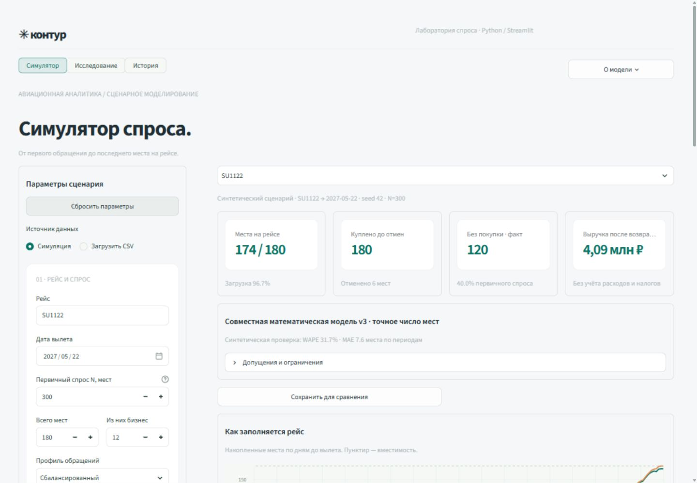

# Контур — математическая модель спроса на авиабилеты

Нативное приложение на Python и Streamlit для симуляции продаж, восстановления скрытого спроса из бронирований и проверки математической модели. Формы, навигация, таблицы, графики и скачивание файлов создаются Python-компонентами Streamlit. Визуальный стиль «Контур» сохранён: светлый фон, зелёные акценты, панели параметров и карточки показателей.



## Запуск

Нужен Python **3.12 или новее**. Проверенные зависимости закреплены в `requirements.txt`: Streamlit, NumPy, pandas, SciPy и Altair.

1. Распакуйте проект или клонируйте репозиторий.
2. Windows: запустите **START-WINDOWS.cmd**. macOS/Linux: выполните `sh start.sh`.
3. Откройте **http://127.0.0.1:8501**. Оставьте окно сервера открытым; остановка — Ctrl+C.

Первый запуск создаёт `.venv` и устанавливает зависимости из интернета. Из уже настроенной среды приложение запускается командой `python -m streamlit run app.py`. Сервер по умолчанию слушает только локальный адрес.

## Симулятор

Настройте первичный спрос, вместимости C/Y, тариф, бюджеты, профиль обращений и возвраты, затем запустите расчёт. Один seed сохраняет первичный поток групп при сравнении цены и вместимости. Модель имитирует покупку группы целиком, динамические тарифы, общий остаток мест каждого салона и возвраты.

Можно загрузить несколько bookings CSV и историю предложений offers, выбрать рейс, смотреть накопительный и ежедневный журналы, спрос по периодам, тарифные классы, причины отказов и passenger-подобную реконструкцию. У наблюдаемых операций и модельных бюджетов различается происхождение. Для сравнения сценариев можно сохранить текущий результат как базу в сессии приложения.

Экспорт формируется на Python: bookings, реконструкция, события, ежедневный журнал, оценки по периодам, действительная история предложений и JSON параметров с диагностикой. Кнопки скачивания — штатные компоненты Streamlit.

## Исследование

- **Проверка по passengers.** Эталон используется после восстановления. Оцениваются MAE/WAPE скрытого спроса по периодам, покрытие условных интервалов, взвешенные по местам распределения бюджетов и доступные метки салонов. Несогласованные bookings/passengers разных запусков отклоняются.
- **Пакетные эксперименты.** Быстрая серия или 10 сценариев × 100 seed, с парным сравнением v3 и базового метода. Включены ранний/поздний спрос, всплески, смесь бюджетов, закрытия продаж, зависимость бюджета от группы, возвраты и дефицит мест. Неудачные оценки сохраняются в отчёте.
- **Калибровка.** Сетки σ, временного эффекта β, эффекта размера группы и смеси выбираются на обучающих потоках и проверяются на других seed. Применение выбранных параметров выполняется явно. Происхождение калибровки сохраняется; её обучающие seed нельзя повторно использовать в пакетной проверке.
- **Устойчивость.** Повторная оценка при разных σ, силе регуляризации и внешнем N. Дополнительный бутстрап повторно оценивает модель на выборках наблюдаемых покупок при фиксированных offers/N. Диапазон чувствительности не является доверительным интервалом полной неопределённости.
- **Прогноз до вылета.** Срезы за 90/30/14/7 дней. Будущие bookings/offers не входят в оценку параметров. Исторический N задаётся сценарно через полный внешний N и временной профиль; будущие предложения продолжают последнее известное состояние. Фактический будущий журнал используется после прогноза для проверки.
- **Тарифные политики.** Постоянная цена, текущая динамика, управление открытием вложенных RBD и подбор из 12 кандидатов. Общая вместимость салона не дублируется по классам. Подбор и проверка используют разные seed. Прибыль рассчитывается только при заданных постоянных расходах и расходах на занятое место.

Пакетные эксперименты, калибровка и тарифные политики используют независимые синтетические сценарии. Проверка, устойчивость и прогноз также работают с загруженным рейсом. Для полного синтетического комплекта можно сформировать согласованные bookings, offers, passengers и конфигурацию.

## Данные и ограничения

`examples/curator/` содержит два bookings и соответствующие эталонные passengers, предоставленные куратором. Это журналы симулятора, а не заявленные реальные коммерческие данные авиакомпании. Для них дата вылета — **2027-05-22**; известный из сценария первичный спрос — **300 мест на рейс**. Фактическая история offers к этим журналам не предоставлялась: её необходимо загрузить отдельно.

`examples/complete/` — собственный согласованный синтетический комплект с закрытиями продаж. Задайте N=300 и дату 2027-05-22. Загружайте bookings и offers для восстановления, а passengers — в блок проверки. Описание offers находится в `examples/OFFERS.md`.

Минимальный bookings CSV:

```csv
timestamp;cabin;rbd;commercial;price
2027-05-01T12:00:00Z;Y;R;2;12000
2027-05-02T12:00:00Z;Y;R;-1;12000
```

`commercial` — ненулевое целое число мест: положительное для покупки, отрицательное для отмены; `price` — положительная цена за место. Необязательный `flight` задаёт рейс; иначе рейс определяется из имени `bookings-SU1122-2027-05-22.csv`. RBD по убыванию цены: C — `JOCIZ`, Y — `YXDSBMUPKHLQTENRGV`.

Поддерживаются UTF-8/BOM, разделители `;`, запятая и табуляция, UTC и даты вида `2026-11-30 20:04:32 UTC`. Время без зоны считается UTC. Ограничения: 10 МБ входных CSV, до 25 000 операций, для точной интерактивной v3 — N ≤ 1500 мест на рейс.

## Математическая модель

v3 использует составной пуассоновский поток групп, логнормальный бюджет, вероятность покупки при заданных цене/доступности и регуляризованное правдоподобие. Это вероятностная математическая модель; целевые passengers не используются при восстановлении.

```text
Скрытый спрос = внешний первичный спрос − покупки до отмен
Баланс мест  = покупки − отмены
Выручка      = сумма(commercial × price)
```

Общий спрос из одного bookings не идентифицируется и задаётся извне. Отмена не является новым первичным обращением. Без offers цены приближаются по покупкам, а доступность считается неизвестной и условно неограниченной. Нулевые продажи сами по себе не означают отсутствие спроса.

В реконструкции `amount` — модельный предельный бюджет за место, а не известная цена. Скрытые строки, время и причины отказов являются возможным объяснением журнала, а не восстановленными личностями. Интервалы 10–90% условны при оценённых параметрах и не включают полную неопределённость предположений.

Две постановки v3 используют тот же внешний N: `fixed_design` означает заранее заданное число первичных мест, `observed_total` — внешний наблюдённый итог случайного потока. Происхождение ядра и локальные исправления описаны в `model/README.md` и `model/provenance.json`.

## История и отчёты

Данные хранятся локально в `runtime/history.sqlite3`: входные параметры и CSV, версия приложения, хеш кода, статусы и результаты. Одинаковые CSV хранятся один раз. Историю можно открыть и повторить; повторный запуск создаёт отдельную запись. Для резервной копии сохраните каталог runtime после остановки сервера. Он не входит в Git или релизный архив.

Исследования выполняются в фоновой очереди, до трёх задач. Прогресс и отмена доступны в интерфейсе. Остановка выполняется после текущей операции модели. После перезапуска сервера незавершённые задачи помечаются прерванными; автоматического продолжения с середины нет.

Самостоятельный HTML-отчёт и ZIP создаются на Python. ZIP содержит таблицы CSV, JSON результатов, конфигурацию, версию кода и исходные загруженные файлы. HTML-отчёт можно открыть без приложения и распечатать.

## Проверка и структура

```text
app.py           — запуск и навигация Streamlit
ui/              — Python-экраны, оформление и графики
backend/         — расчёты, импорт, исследования, очередь, история и экспорт
model/           — математическое ядро v3 и условные распределения
examples/        — предоставленные и согласованные синтетические данные
scripts/         — интеграционная проверка исследовательских расчётов
tests/           — математические, прикладные и интерфейсные проверки
docs/RESULTS.md  — результаты полной серии 10 × 100
```

Запуск тестов: `python -m unittest discover -s tests -p "test_*.py" -v`. Интеграционная проверка с формированием отчётов: `python scripts/verify_research.py --output outputs/research-verification`. GitHub Actions устанавливает Python-зависимости и выполняет тесты.

Версия `kontur-native-v5` прошла 69 тестов, шесть интеграционных исследовательских расчётов и проверку в браузере: импорт двух рейсов, перерасчёт, история и скачивание отчётов. Результаты проверки записаны в `docs/verification.json`.

В `docs/benchmark-1000.json` сохранены 2000 оценок двух методов на 1000 реализациях. Средняя MAE v3 против baseline составила 10,02 против 16,76 места; v3 лучше в 77,6% пар. Покрытие условных 80%-интервалов — 56,44%, что отмечено как ограничение. Эти результаты относятся к указанным синтетическим сценариям и не подтверждают точность на реальном рынке.
